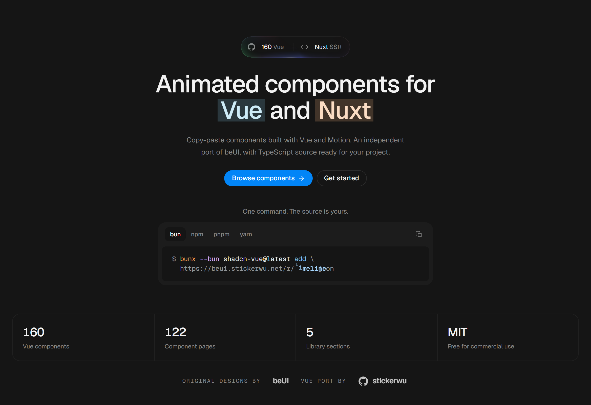
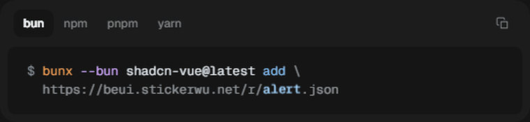
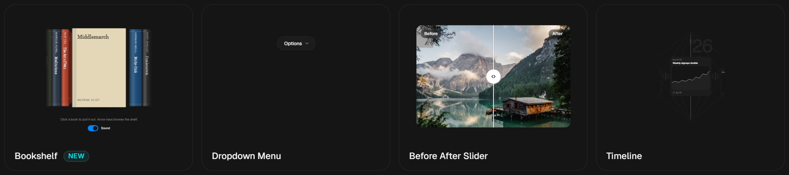
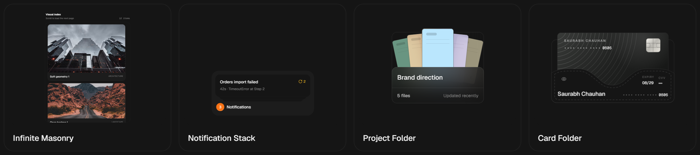
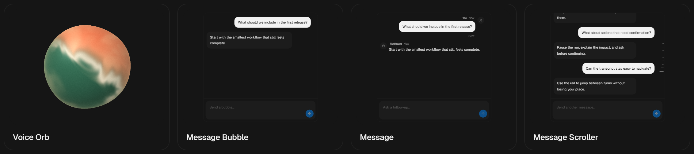
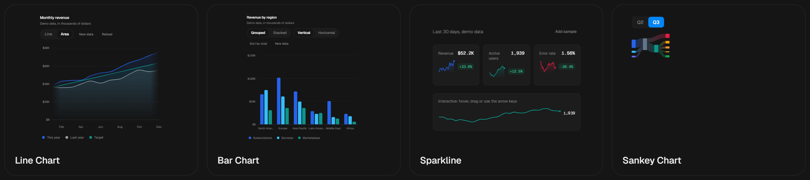
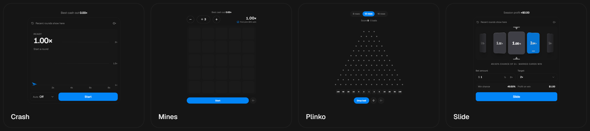
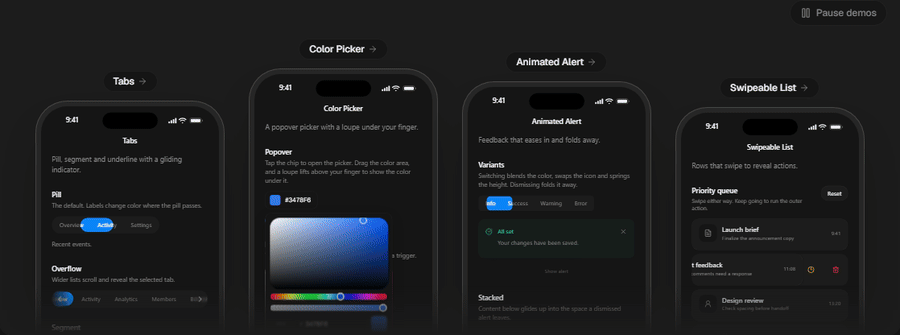

<div align="center">

<a href="https://beui.stickerwu.net/en/"></a>

# beui-vue

**beUI's motion components and UI blocks, rebuilt for Vue 3**

Copy-paste components built with Vue 3 and motion-v. 160 components, TypeScript source, Nuxt SSR ready, one command to add any of them to your project.

[](./LICENSE)
[](https://vuejs.org/)
[](https://beui.stickerwu.net/en/install)
[](https://www.typescriptlang.org/)
[](https://www.npmjs.com/package/beui-vue)
[](https://beui.stickerwu.net/en/install#shadcn-vue)

[Docs](https://beui.stickerwu.net/en/) · [All components](https://beui.stickerwu.net/en/catalog) · [Installation](https://beui.stickerwu.net/en/install) · [GitHub](https://github.com/stickerwu/beui-vue) · [Gitee](https://gitee.com/stickerwu/beui-vue) · [中文](./README.md)

<a href="https://beui.stickerwu.net/en/"></a>

</div>

## ✨ Features

- **The whole library**: a Vue implementation of all 160 public beUI web items, across components, blocks, AI agents, charts and games, on 122 documentation pages.
- **Faithful motion**: spacing, type, spring settings and demo content are compared item by item with [beui.dev](https://beui.dev), and progress is tracked per variant.
- **Two ways to install**: copy the source into your project with the shadcn-vue CLI and own the code, or install the npm package and import.
- **Written for Vue**: `<script setup>` with TypeScript, `v-model` with controlled and uncontrolled use on larger components, and slots for composition.
- **Nuxt SSR**: works with server rendering out of the box. The package ships compiled CSS, so there is no Tailwind setup.
- **For every user**: follows the system's reduced-motion setting, works with the keyboard and screen readers, and has light and dark themes. User-facing strings can be translated through `labels`.

## 🚀 Installation

### Option 1: shadcn-vue CLI (copy the source)



Every component is published as a shadcn-vue registry item, and `@beui-vue` is listed in the [official shadcn-vue directory](https://shadcn-vue.com/docs/directory), so you install by name with no setup. The CLI copies the TypeScript source into `components/beui` and adds the dependencies to your `package.json`:

```sh
npx shadcn-vue@latest add @beui-vue/tabs
```

Initialise the project with `npx shadcn-vue@latest init` first. You can add several components in one command. Files they share are written once, so adding more never conflicts. Then import the shared styles once in your app entry:

```ts
import '@/components/beui/styles.css'
```

> The full URL works the same way:
>
> ```sh
> npx shadcn-vue@latest add https://beui.stickerwu.net/r/tabs.json
> ```

### Option 2: npm package

In a **Vue 3.5 or newer 3.x** project, install the preview from npm:

```sh
npm install beui-vue@next
```

For Nuxt, add `beui-vue/style.css` to the `css` array in `nuxt.config.ts`. See the [installation guide](https://beui.stickerwu.net/en/install).

## 🧩 Usage

```vue
<script setup lang="ts">
import { ref } from 'vue'
import { ButtonBase, Tabs } from 'beui-vue'
import 'beui-vue/style.css'

const view = ref('overview')
const items = [
  { value: 'overview', label: 'Overview' },
  { value: 'activity', label: 'Activity' },
  { value: 'settings', label: 'Settings' },
]
</script>

<template>
  <Tabs v-model="view" :items="items" />
  <ButtonBase>Save changes</ButtonBase>
</template>
```

Every component page has a live demo, usage code, an API table and a link to the original beUI component.

## 🤖 For AI coding agents

Let Claude Code, Codex, Cursor and other agents pick beui-vue components instead of writing their own motion code:

- **Agent skill**: tells the agent to look for an existing beui-vue component first and install it by slug.

  ```sh
  npx skills add stickerwu/beui-vue --skill beui-vue
  ```

- **MCP server**: `https://beui.stickerwu.net/mcp` (Streamable HTTP, no key), with `list_components`, `search_components`, `get_component` and `get_install_command`.

  ```sh
  claude mcp add --transport http beui-vue https://beui.stickerwu.net/mcp
  ```

- **Machine-readable indexes**: [llms.txt](https://beui.stickerwu.net/en/llms.txt), [llms-full.txt](https://beui.stickerwu.net/llms-full.txt) and the shadcn-vue registry [r/index.json](https://beui.stickerwu.net/r/index.json).

See the [AI agent guide](https://beui.stickerwu.net/en/docs/ai-agents).

## 🎨 Components

### [Components](https://beui.stickerwu.net/en/components/motion) · 59

<a href="https://beui.stickerwu.net/en/components/motion"></a>

### [Blocks](https://beui.stickerwu.net/en/components/blocks) · 24

<a href="https://beui.stickerwu.net/en/components/blocks"></a>

### [AI Agents](https://beui.stickerwu.net/en/components/agents) · 18

<a href="https://beui.stickerwu.net/en/components/agents"></a>

### [Charts](https://beui.stickerwu.net/en/charts) · 17

<a href="https://beui.stickerwu.net/en/charts"></a>

### [Games](https://beui.stickerwu.net/en/casino) · 4

<a href="https://beui.stickerwu.net/en/casino"></a>

### Just as smooth on a phone



| To build | Open the demo |
| --- | --- |
| Switching views, or comparing before and after | [Tabs](https://beui.stickerwu.net/en/components/motion/tabs) · [Before After Slider](https://beui.stickerwu.net/en/components/motion/before-after-slider) · [Color Picker](https://beui.stickerwu.net/en/components/motion/color-picker) |
| Stacked notifications or a masonry feed | [Notification Stack](https://beui.stickerwu.net/en/components/blocks/notification-stack) · [Infinite Masonry](https://beui.stickerwu.net/en/components/blocks/infinite-masonry) · [Swipeable List](https://beui.stickerwu.net/en/components/blocks/swipeable-list) |
| An AI chat interface | [Message Bubble](https://beui.stickerwu.net/en/components/agents/message-bubble) · [Voice Orb](https://beui.stickerwu.net/en/components/agents/voice-orb) |
| Trends and flows | [Line Chart](https://beui.stickerwu.net/en/charts/line-chart) · [Sankey Chart](https://beui.stickerwu.net/en/charts/sankey-chart) |
| Game interactions | [Mines](https://beui.stickerwu.net/en/casino/mines) · [Crash](https://beui.stickerwu.net/en/casino/crash/crash) |

## 🛠️ Releases and development

[`beui-vue@0.1.0-alpha.1`](https://www.npmjs.com/package/beui-vue) includes Vue implementations of all 160 public web items. The motion of the 172 demos is reviewed per variant, and the catalog tracks each one. [npm package](https://www.npmjs.com/package/beui-vue) · [Changelog](./vue/packages/ui/CHANGELOG.md)

The Vue components, demos and docs live in [`vue/`](./vue). The [development guide](./vue/README.md) covers local builds, Vite and Nuxt install tests, and screenshot comparisons.

## 🙏 Credits and license

Maintained independently by [stickerwu](https://github.com/stickerwu). The original component and interaction designs come from [beUI](https://beui.dev/) ([starc007/ui-components](https://github.com/starc007/ui-components)) and its contributors. The Vue port is based on [`c0a936f`](https://github.com/starc007/ui-components/tree/c0a936f59eb767e263c0e81b93dd323511dc9b6b), and every component page keeps a link to the upstream source and the original design credit. Released under the [MIT license](./LICENSE).
