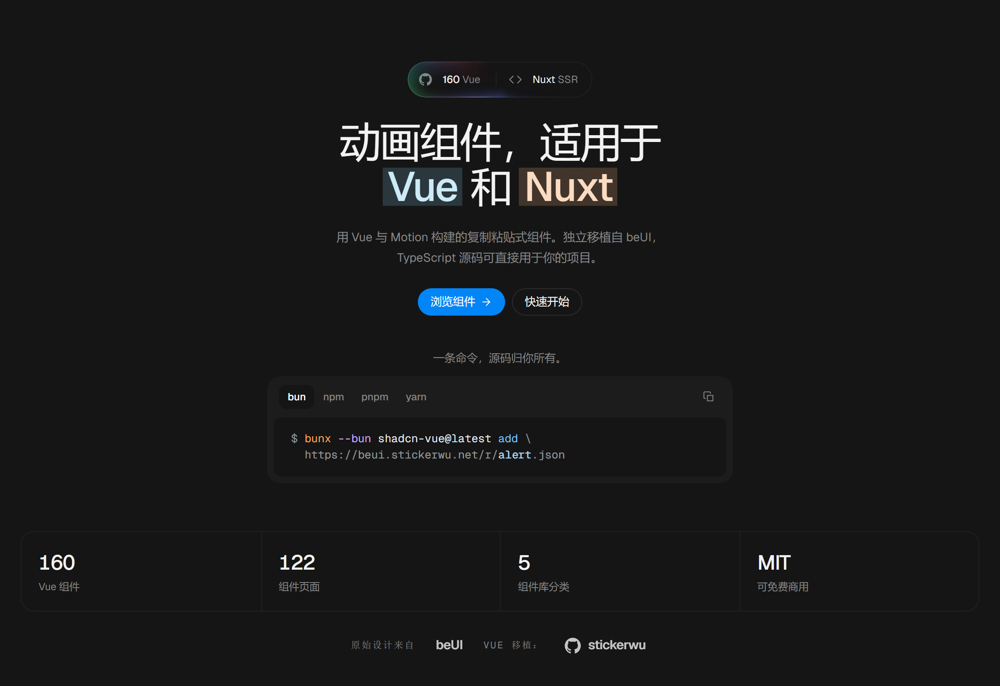
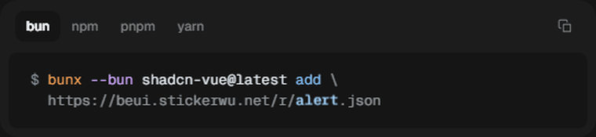
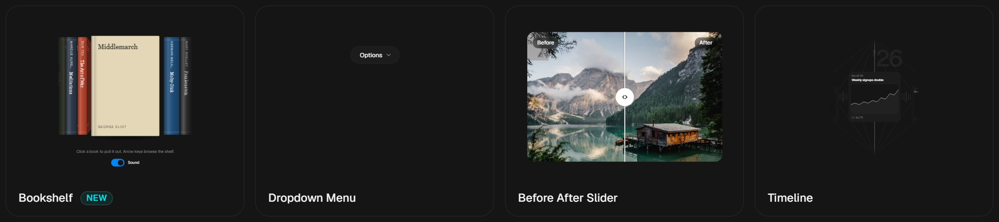
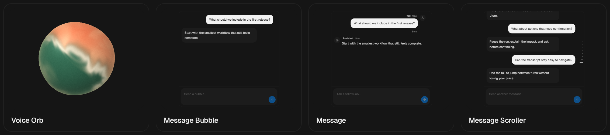
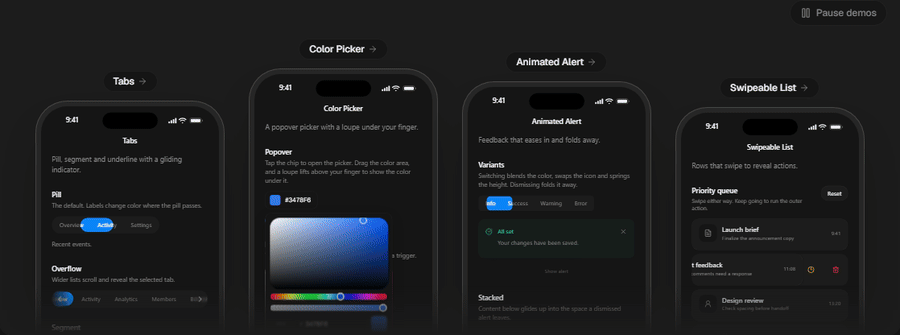

<div align="center">

<a href="https://beui.stickerwu.net/"></a>

# beui-vue

**beUI 动效组件与界面区块的 Vue 3 实现**

用 Vue 3 和 motion-v 构建的复制粘贴式组件。160 个组件，TypeScript 源码，支持 Nuxt SSR，可以一条命令装进你的项目。

[](./LICENSE)
[](https://vuejs.org/)
[](https://beui.stickerwu.net/install)
[](https://www.typescriptlang.org/)
[](https://beui.stickerwu.net/install#shadcn-vue)

[官网文档](https://beui.stickerwu.net/) · [全部组件](https://beui.stickerwu.net/catalog) · [安装指南](https://beui.stickerwu.net/install) · [GitHub](https://github.com/stickerwu/beui-vue) · [Gitee](https://gitee.com/stickerwu/beui-vue) · [English](./README.en.md)

<a href="https://beui.stickerwu.net/"></a>

</div>

## ✨ 特性

- **完整移植**：beUI 全部 160 个公开 Web 条目都有 Vue 实现，分为组件、区块、AI Agents、图表和游戏五类，共 122 个文档页。
- **动效还原**：间距、字号、弹簧参数和演示内容逐项对照 [beui.dev](https://beui.dev)，并按变体审看还原进度。
- **两种安装方式**：用 shadcn-vue CLI 把源码复制进项目，代码归你所有；也可以安装 npm 包直接导入。
- **Vue 的写法**：`<script setup>` + TypeScript，复杂组件支持 `v-model` 受控和非受控两种用法，用插槽组合结构。
- **Nuxt SSR**：服务端渲染开箱可用。包里自带编译好的 CSS，无需配置 Tailwind。
- **照顾到每个用户**：跟随系统的“减弱动态效果”设置，支持键盘操作和屏幕阅读器，自带深浅色主题；界面文案可以通过 `labels` 本地化。

## 🚀 安装

### 方式一：shadcn-vue CLI（复制源码）



每个组件都发布成 shadcn-vue 的 registry 条目，`@beui-vue` 已收录进 [shadcn-vue 官方目录](https://shadcn-vue.com/docs/directory)，不用任何配置就能按名称安装。CLI 会把 TypeScript 源码复制到 `components/beui`，并把依赖写入 `package.json`：

```sh
npx shadcn-vue@latest add @beui-vue/tabs
```

项目需要先用 `npx shadcn-vue@latest init` 初始化。一次可以添加多个组件，各条目共用的文件只写入一次，重复添加也不会冲突。之后在应用入口引入一次共享样式：

```ts
import '@/components/beui/styles.css'
```

> 也可以直接传完整地址，效果相同：
>
> ```sh
> npx shadcn-vue@latest add https://beui.stickerwu.net/r/tabs.json
> ```

### 方式二：npm 包

在 **Vue 3.5 或更新的 3.x** 项目里，从 GitHub Release 安装预览版：

```sh
npm install https://github.com/stickerwu/beui-vue/releases/download/v0.1.0-alpha.0/beui-vue-0.1.0-alpha.0.tgz
```

Nuxt 项目把 `beui-vue/style.css` 加进 `nuxt.config.ts` 的 `css` 数组即可。详见[安装指南](https://beui.stickerwu.net/install)。

## 🧩 使用

```vue
<script setup lang="ts">
import { ref } from 'vue'
import { ButtonBase, Tabs } from 'beui-vue'
import 'beui-vue/style.css'

const view = ref('overview')
const items = [
  { value: 'overview', label: '概览' },
  { value: 'activity', label: '动态' },
  { value: 'settings', label: '设置' },
]
</script>

<template>
  <Tabs v-model="view" :items="items" />
  <ButtonBase>保存更改</ButtonBase>
</template>
```

每个组件页都有可运行的示例、用法代码、API 表格和对应的 beUI 原版链接。

## 🎨 组件一览

### [组件](https://beui.stickerwu.net/components/motion) · 59

<a href="https://beui.stickerwu.net/components/motion"></a>

### [区块](https://beui.stickerwu.net/components/blocks) · 24

<a href="https://beui.stickerwu.net/components/blocks"></a>

### [AI Agents](https://beui.stickerwu.net/components/agents) · 18

<a href="https://beui.stickerwu.net/components/agents"></a>

### [图表](https://beui.stickerwu.net/charts) · 17

<a href="https://beui.stickerwu.net/charts"></a>

### [游戏](https://beui.stickerwu.net/casino) · 4

<a href="https://beui.stickerwu.net/casino"></a>

### 在手机上同样流畅



| 想做什么 | 打开示例 |
| --- | --- |
| 在视图间切换，或拖动比较前后效果 | [标签页](https://beui.stickerwu.net/components/motion/tabs) · [对比滑块](https://beui.stickerwu.net/components/motion/before-after-slider) · [颜色选择器](https://beui.stickerwu.net/components/motion/color-picker) |
| 折叠通知，或用瀑布流展示卡片 | [通知堆叠](https://beui.stickerwu.net/components/blocks/notification-stack) · [无限瀑布流](https://beui.stickerwu.net/components/blocks/infinite-masonry) · [滑动列表](https://beui.stickerwu.net/components/blocks/swipeable-list) |
| 构建 AI 对话界面 | [消息气泡](https://beui.stickerwu.net/components/agents/message-bubble) · [语音球](https://beui.stickerwu.net/components/agents/voice-orb) |
| 展示趋势和流向 | [折线图](https://beui.stickerwu.net/charts/line-chart) · [桑基图](https://beui.stickerwu.net/charts/sankey-chart) |
| 搭建游戏交互 | [Mines](https://beui.stickerwu.net/casino/mines) · [Crash](https://beui.stickerwu.net/casino/crash/crash) |

## 🛠️ 版本与开发

`0.1.0-alpha.0` 包含全部 160 个公开 Web 条目的 Vue 实现。172 组演示的动效按变体审看，目录逐项记录还原进度。[预览版与校验和](https://github.com/stickerwu/beui-vue/releases/tag/v0.1.0-alpha.0) · [效果对照与验收](https://beui.stickerwu.net/verification)

Vue 组件、示例和文档都在 [`vue/`](./vue) 目录。本地构建、Vite 与 Nuxt 安装测试和截图对照的方法见[开发指南](./vue/README.md)。

## 🙏 来源与许可

本项目由 [stickerwu](https://github.com/stickerwu) 独立维护。原始组件与交互设计来自 [beUI](https://beui.dev/)（[starc007/ui-components](https://github.com/starc007/ui-components)）及其贡献者。Vue 移植以 [`c0a936f`](https://github.com/starc007/ui-components/tree/c0a936f59eb767e263c0e81b93dd323511dc9b6b) 为基准，组件页保留上游源码链接和原设计署名。项目遵循 [MIT 许可证](./LICENSE)。
